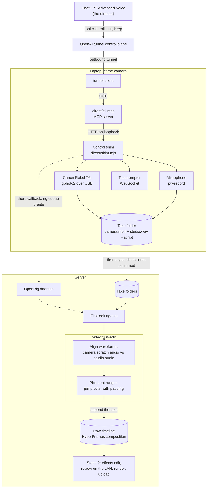

# video

A two-stage, two-machine pipeline for recording and finishing narrated videos, driven by voice and
by coding agents.

| Stage | Folder | Machine | What happens | Output |
| --- | --- | --- | --- | --- |
| 1. Direct + first edit (live) | [`direct/`](direct/) | Laptop, at the camera; the cut runs on the server | Record takes hands-free; each take is uploaded and cut into the raw narration as you film | A raw timeline that grows take by take |
| 2. Effects edit + upload | [`edit/`](edit/) | Server | Green screen removal, b-roll, effects, review in a browser, render, upload | The finished video, published |

> **In development.** Everything here is being built in the open and will change. Today stage 2's
> editors are set up and working, and stage 1 records takes on the laptop: camera, microphone and
> teleprompter together. The upload, the callback and the first edit are designed but not built. See
> [Open decisions](#open-decisions).

## How it fits together



Solid lines are built; dashed lines are designed and not built yet. Each link is described in
[ARCHITECTURE.md](ARCHITECTURE.md).

## Commands

One command per mode, from the repo root. Arguments go after `--`. `bin/direct` and `bin/edit` are
the same things without npm: `bin/direct start <session>`, `bin/direct roll`, `bin/edit <project>`.

| Command | Machine | What it does |
| --- | --- | --- |
| `npm run video:direct` | Laptop | Check the laptop; with `-- <session>`, start the teleprompter and the control shim |
| `npm run video:first-edit` | Server | Align each uploaded take, cut every reading into its own piece, sort the pieces by idea; `first-edit/assemble` then puts them on the raw timeline. Built, tested on a sample take only; see [`first-edit/README.md`](first-edit/README.md) |
| `npm run video:edit` | Server | List projects; with `-- <project>`, open its editor on the LAN |

## Stage 1: direct + first edit (laptop, cut on the server)

You record alone. ChatGPT Advanced Voice is the director: you talk to it with its sound off, and it
drives the session through a small control shim on the laptop.

**Direct.** The voice session controls three things:

- **Teleprompter** — its own git repo. Load a script, start, pause, scroll back to a line, change
  speed.
- **Camera** — a Canon Rebel T6i over USB, through a USB camera-control project wrapped by a shim:
  start and stop recording, check that it is rolling.
- **Mic input** — the studio microphone: arm, start and stop its recording together with the
  camera, so every take has both.

Each take leaves two recordings of the same performance: the camera's video with its own **scratch
audio**, and the microphone's **studio audio**.

**First edit (live).** The cut happens on the server, one take at a time, while you keep filming:

1. When a take closes, the laptop uploads its folder to the server and confirms every file arrived
   intact.
2. Only then does the laptop call back to the OpenRig on the server. That callback is how the voice
   director orchestrates the cut; nobody starts it by hand.
3. The rig's editor agents align the scratch audio to the studio audio, so the studio track replaces
   the camera's sound in sync.
4. They cut every reading into its own piece and sort the pieces by idea, checked against the
   teleprompter script. Nothing is thrown away: a line's retakes and false starts sit in one
   lettered folder with it, and one reading of each idea is marked as suggested.
5. They append the take to the session's **raw timeline**, one clip per idea using the suggested
   reading, with a little padding left on each side so a person can trim it or swap in another
   reading.

The raw timeline is a HyperFrames (HeyGen) composition. It trails the live filming by the time one
take needs to upload and be cut, and catches up take by take. By the end of the session the whole
piece is laid out and ready for human edits.

Nothing creative happens here. No effects, no keying, no b-roll: only what was said, tightened.

## Handoff: laptop → server

Handoff is per take, not per session. A take travels as one folder: the camera file, the studio
audio, the script and the teleprompter log. The media is large and is copied, not committed. The raw
timeline is small text, is written on the server and lives in git.

On the server the media lands on a large disk outside this repository, at
`<content root>/<video-slug>/`. The content root is specific to each machine, so it is written in a
`PATH.md` at the repository root that is git-ignored and never published.

## Stage 2: effects edit + upload (server)

The server takes the raw timeline as its starting point and a second team of agents finishes it:
green screen removal, b-roll overlays, titles, captions, music, effects. Two HTML-to-video tools do
the work, both built for coding agents:

- [OpenFilm](https://github.com/openfilm/openfilm) — a `film.html` timeline of clips and pages.
- [HyperFrames](https://github.com/heygen-com/hyperframes) — HTML compositions rendered to video.

You review and adjust from any browser on the LAN:

```sh
edit/launch              # list projects and what is running
edit/launch <project>    # start its editor and print the address to open
```

Then render and upload. See [`edit/README.md`](edit/README.md) for setup, the LAN details and their
limits.

## Layout

```
ARCHITECTURE.md    how the voice director, the laptop and the server connect
PATH.md            this machine's content root (git-ignored, you create it)
bin/direct         stage 1 command (wraps direct/launch and direct/ctl)
bin/edit           stage 2 command (wraps edit/launch)
package.json       the video:direct, video:first-edit and video:edit commands
direct/            stage 1, runs on the laptop
  launch           check the laptop, start or stop a session
  ctl              roll, cut, status and the other commands
  shim.mjs         the control shim behind both, and its MCP server for ChatGPT
first-edit/        the cut between the stages, runs on the server; rig/ is its agent team
edit/              stage 2, runs on the server
  launch           open a project's editor on the LAN
  projects/        one folder per video (of-demo and hf-demo are working samples)
  bin/openfilm     OpenFilm, pinned and patched to serve the LAN
  tools/openfilm   that pinned copy and its patch
.claude/skills/    agent skills for OpenFilm and HyperFrames
```

## Open decisions

These are not settled, and stage 1 cannot be built until they are:

1. **Teleprompter** — settled: [Teleprompter](https://github.com/Abhishekingle662/teleprompter) 0.3.0,
   driven over its WebSocket remote and its watched script file. It cannot seek to a line or report
   the line on screen, so `prompter to <line>` is not available.
2. **Camera USB project** — settled: [gphoto2](https://github.com/gphoto/gphoto2). It starts and
   stops movie recording to the card on the T6i and downloads the clip; see `direct/README.md`.
3. **How ChatGPT reaches the laptop** — the shim is an MCP server (`direct/ctl mcp`) behind an OpenAI
   tunnel; the profile is `direct/tunnel.example.yaml`. Not tried with Advanced Voice yet.
4. **Mic recording** — recorder settled: `pw-record`, on the default source or `DIRECT_MIC`. Which
   device is the studio microphone is still open.
5. **Raw timeline format** — a HyperFrames (HeyGen) composition, extended one take at a time. Still
   open: how the composition is laid out so appending a take does not disturb earlier human edits.
6. **Media transfer** — the destination is decided: `<content root>/<video-slug>/` on the server.
   Proposed for the copy: `rsync` of each take folder, confirmed by checksum before the callback.
7. **OpenRig callback** — mechanism proposed: `rig queue create --host` from the laptop (see
   [ARCHITECTURE.md](ARCHITECTURE.md)). Open: which rig and seat receive it, and the server's address.
8. **Padding** — how much to leave around each kept range, and when a clean jump cut is used
   instead.
9. **Upload target** — where the finished video goes (YouTube or elsewhere) and with what account.

## License

MIT; see [LICENSE](LICENSE). Bundled agent skills and the HyperFrames sample keep their own licenses; see
[THIRD_PARTY.md](THIRD_PARTY.md).
