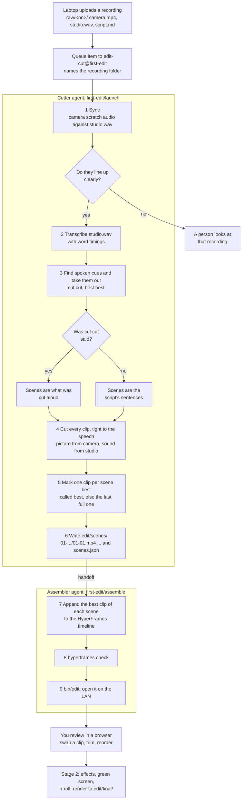

# first-edit — the cut between recording and effects (server)

Turns each uploaded recording into scenes and clips and puts the best clips on the raw timeline.
Runs on the server, after stage 1 uploads a recording and before stage 2 adds effects. An
[OpenRig](https://github.com/mvschwarz/openrig) team named `first-edit` does it unattended. See the
[top-level README](../README.md).

Built and run end to end on generated sample recordings, by hand and through the team. Not yet
tried on a real recording from the camera.

## Words

| Word | Means |
| --- | --- |
| **Recording** | One continuous run of the camera and microphone from stage 1, uploaded as one numbered folder. |
| **Scene** | One part of the video. A recording holds one or more scenes. |
| **Clip** | A candidate for a scene: one try at saying it. Also called a cut or a take. A scene holds one or more clips, and one of them is the best. |

## Where files go

Media lives on the content disk, outside this repository. The content root is specific to each
machine and is written in the git-ignored `PATH.md` at the repository root.

```
<content root>/
  0001-video-project-slug/                 one video: a 4-digit number and a slug
    raw/                                   what the laptop uploads; only ever read after that
      01/                                  first recording
        camera.mp4
        studio.wav
        script.md
      02/                                  second recording
    edit/
      scenes/
        scenes.json                        every scene and clip, the best, the cues heard
        01-welcome-to-the-series/          scene 01
          01-01.mp4                          clip 01
          01-02.mp4                          clip 02
          01-03-best.mp4                     clip 03, the best
        02-how-a-recording-gets-uploaded/  scene 02
          02-01-best.mp4
        03-what-the-agents-do-next/        scene 03
          03-01.mp4
          03-02-best.mp4
      final/
        0001-video-project-slug.mp4        the finished video

<repository>/edit/projects/0001-video-project-slug/    the timeline: small text, kept in git
```

- **Everything is numbered, with leading zeros,** so sorting by name is sorting by time: videos
  with four digits, recordings, scenes and clips with two.
- **Scenes are numbered through the whole video,** not per recording. A second recording carries
  on from the last scene number.
- **A clip's name stands alone:** `01-03-best.mp4` is scene 01, clip 03, the best.
- **One name per video everywhere:** the folder on the disk, the project in `edit/projects/`, and
  the final file.
- **`raw/` and `edit/` never mix.** First edit reads `raw/` and writes only under `edit/`, so the
  whole of `edit/scenes/` can be deleted and cut again.

## The pipeline



Steps 1 to 6 are `first-edit/launch`; steps 7 to 9 are `first-edit/assemble` and `bin/edit`. The
two agents run those commands, check the result, and pass the recording along.

## Directing the cut aloud

While recording, you say what you want cut. Each cue is a word said twice, so it does not turn up
in ordinary speech; the cues are trimmed out of the clips.

| Say | Means |
| --- | --- |
| **"cut cut"** | This scene is finished. Everything said since the last cut is one scene; the next thing said starts a new one. |
| **"best best"** | The clip just finished is the one to use for this scene. |
| **"cut"**, once, as the last word | Stops the camera. It is trimmed off the end of the recording; anywhere else "cut" is an ordinary word. |

The glossary is [`glossary.json`](glossary.json); add a line there to add another way of saying a
cue. A new kind of cue (something other than cut, best and end) needs code as well.

Inside a scene, a new clip starts when you begin the scene again from its opening words, or after
you call one best. If you never say "best best" in a scene, the last full clip is the best.

When no "cut cut" is heard in a recording, the script decides instead: each script sentence is a
scene, and its retakes and false starts are its clips. A remark that is not in the script gets its
own scene, placed where it was said, and stays off the timeline. With neither cues nor a script,
clips that begin with the same words share a scene.

## Commands

```sh
first-edit/launch <video folder>/raw/<nn>            # sync, cut into scenes and clips under edit/scenes/
first-edit/launch <video folder>/raw/<nn> --plan     # decide and print, write nothing
first-edit/assemble <video folder>/raw/<nn>          # add that recording's best clips to the timeline
bin/edit <nnnn-video-slug>                           # open the timeline in a browser on the LAN
```

`launch` needs [uv](https://docs.astral.sh/uv/) and ffmpeg; the first run downloads the Whisper
model and, for the GPU, about 1 GB of libraries. Options: `--gap` (without spoken cuts, a pause
this long starts a new clip, default 0.6 s), `--pad` (room kept around each clip, default 0.15 s),
`--model`, `--force`.

Recordings are cut in order. Cutting a recording again keeps its scene numbers; if it would now
give a different number of scenes while later recordings are already cut, it stops rather than
renumber scenes the timeline points at.

`assemble` only ever appends: clips already on the timeline are not moved, so a person's trims are
kept. The scenes folder is linked into the project, not copied.

## The team

[`rig/rig.yaml`](rig/rig.yaml) is the saved OpenRig team, named `first-edit`: two Claude Code
agents. One queue item is one recording.

| Seat | Does | Hands on to |
| --- | --- | --- |
| `edit-cut@first-edit` | Runs `first-edit/launch`, checks the scenes and clips against what was said, reruns with other options if needed | `edit-assemble@first-edit` |
| `edit-assemble@first-edit` | Runs `first-edit/assemble`, checks the composition, opens it with `bin/edit` | the person, in the item's resolution |

```sh
rig specs add first-edit/rig                   # once: save the team in this machine's OpenRig library
rig up first-edit --yes                        # start it (from the repository root)
rig queue create --source upload@external --destination edit-cut@first-edit \
  --summary "First edit 0001-video-project-slug recording 01" \
  --body "Recording folder: <content root>/0001-video-project-slug/raw/01"
rig ps --nodes --rig first-edit                # what the agents are doing
rig down first-edit                            # stop it
```

That `rig queue create` is what the laptop sends after an upload is verified (see
[ARCHITECTURE.md](../ARCHITECTURE.md)); until the laptop does, run it by hand.

The agents run unattended: the team uses Claude's auto permission mode, which decides each action
itself instead of stopping to ask, and the commands above are allowed outright. While the team
runs, OpenRig keeps a managed block in this repository's `CLAUDE.md` and writes
`.claude/settings.local.json` (git-ignored); `rig down` removes the block. The agents use your
Claude account while they work.

## Try it without a camera

```sh
V=<content root>/9901-sample-video
uv run first-edit/test/make-sample-recording.py $V/raw/01 --cues
first-edit/launch   $V/raw/01
first-edit/assemble $V/raw/01
bin/edit 9901-sample-video
```

The sample is synthetic speech directed aloud: three scenes closed by "cut cut", with 3, 1 and 2
clips, the first scene's third clip called best, and a camera file that starts 0.27 s before the
studio recording. Expect `studio = camera -0.270 s`. Samples and tests are numbered 9900 and up,
which keeps them apart from real videos; their projects are git-ignored. Without `--cues` it makes a recording with no
spoken cuts (a false start, a retake and an unscripted remark) that is sorted by its script
instead. Both are a speech synthesiser, so they show the sorting works, not that the cues are
heard reliably in a real voice.

## Known limits

- Tested only on generated samples. The sync is trusted when the match is clear (the best offset
  stands at least 1.5 times above any other) and alike (the two recordings correlate at 0.25 or
  more once lined up). Those two limits were set on synthetic recordings and on silence, not yet
  on real ones; a recording that fails them is left for a person.
- The transcriber can leave out a stumble or a repeated word, so a very short false start may not
  become a clip.
- Without spoken cuts, a scene is a script sentence. A script written as long sentences gives long
  clips.
- With spoken cuts, a clip is kept whole, pauses between its sentences included; tightening those
  is left to the timeline.
- A cue the transcriber mishears is missed, and its words stay in a clip. `scenes.json` lists the
  cues that were heard, so a missing one shows.
- A clip that the camera did not film (it started late or stopped early) is kept as sound only
  and left off the timeline.
