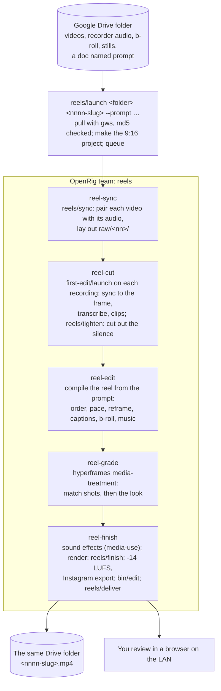

# reels — prompted reels from Google Drive (server)

The second way to make content here (the first is **continuous**: record live with `direct/`, cut
as you film with `first-edit/`, finish with `edit/`; see the [top-level README](../README.md#two-ways-to-make-content)).
Reels start from footage that is already shot and sitting in a Google Drive folder. You give the
folder and a prompt; the server pulls the footage and an [OpenRig](https://github.com/mvschwarz/openrig)
team named `reels` makes a vertical reel for Instagram from it, unattended:

**sync sound to picture → cut → cut out the silence → compile and edit → color grade → sound effects → normalize the sound → render →
review on the LAN → upload back to Drive.**

Built and run end to end on generated sample footage by hand (sync, cut, a stand-in edit, render,
finish). Not yet run through the team, nor on real phone footage or a real Drive folder.

## The flow



| Seat | Does | Command it runs |
| --- | --- | --- |
| `reel-sync@reels` | Pairs each video with the separate audio of the same moment, by its scratch sound | `reels/sync` |
| `reel-cut@reels` | Cuts each recording into clips, sorted into scenes, the best of each marked; then cuts every pause over 0.3 s out of each clip | `first-edit/launch`, `reels/tighten` |
| `reel-edit@reels` | The creative seat: builds the 9:16 HyperFrames composition the prompt asks for | `npx hyperframes` |
| `reel-grade@reels` | A correction so shots match, then the prompt's look | `hyperframes media-treatment`, `grade-compare` |
| `reel-finish@reels` | Adds sound effects (whooshes into changes of idea, a pop on the closing line), balances the mix, renders, normalizes loudness, exports for Instagram, uploads | `hyperframes render`, `reels/finish`, `reels/deliver` |

The sync and the cut are first edit's own code (`first-edit/cut.py`), so a reel's clips come out in
the same shape as a continuous video's. Seat guidance is in [`rig/agents/`](rig/agents/).

## Where files go

```
<content root>/<nnnn-reel-slug>/
  drive/                 the Drive folder as downloaded, prompt.md, source.json. Only read after the pull.
  raw/
    sync.json            each file: which recording it became, or b-roll, still, unmatched audio
    01/  camera.mp4 -> ../../drive/IMG_0412.MP4   studio.wav   (one video and its stretch of the audio)
  edit/
    scenes/              the cut clips and scenes.json, as first edit makes them
    tight/               the same clips with the silence cut out, and tight.json (reels/tighten)
  fetched/               outside assets from reels/fetch, and fetched.json (who made each)
    final/
      <nnnn-reel-slug>-master.mp4   the HyperFrames render
      <nnnn-reel-slug>.mp4          normalized and encoded for Instagram; this is what is uploaded
      delivered.json                its Drive link
<repository>/edit/projects/<nnnn-reel-slug>/   the 1080x1920 composition, kept in git
  assets/drive, assets/scenes, assets/tight    links to the content disk (git-ignored)
```

Reels share the content root, the numbering and the rule that each folder is written by one step
with continuous videos ([first-edit/README.md](../first-edit/README.md#where-files-go)). Give a reel
its own four-digit number; samples are 9900 and up.

## Setup

Once, on the server, as well as the `edit/` setup:

```sh
gws auth login                    # the Google Workspace CLI, signed in to the Drive that holds the footage
reels/photos --login              # optional: read-only Google Photos sign-in, for reels/photos
rig specs add reels/rig           # save the team in this machine's OpenRig library
rig up reels --yes                # start it (from the repository root); rig down reels stops it
```

Needs [`gws`](https://github.com/googleworkspace/cli), jq, ffmpeg, uv, and `CONTENT_ROOT` in `.env`
or `PATH.md`. For `reels/photos`, turn on the
[Photos Picker API](https://console.cloud.google.com/apis/library/photospicker.googleapis.com) in
the Google Cloud project `gws` signs in through. `.env` may set `REELS_DRIVE_OUTPUT` (a Drive folder for finished reels; empty means
the folder the footage came from) and `REELS_SEAT`.

## Commands

```sh
bin/reel <drive folder URL or id> <nnnn-slug> --prompt "<what the reel is>"   # pull, set up, queue
bin/reel <drive folder> <nnnn-slug> --prompt-file brief.md
bin/reel <drive folder> <nnnn-slug> --plan        # list what would be pulled; change nothing
bin/reel <drive folder> <nnnn-slug> --no-queue    # pull and set up only, for working by hand
bin/reel <drive folder> <nnnn-slug> --prompt "…" --asset <instagram url>   # also fetch the clip being reacted to
bin/reel fetch   <nnnn-slug> <url> [--name <name>]  # download an outside asset later
bin/reel photos  <nnnn-slug> [--new] [--max N]   # pick shots in Google Photos into drive/ (read only)
bin/reel photos  <nnnn-slug> <share link> --new   # or download what a Google Photos share link shares
bin/reel local   <nnnn-slug> --prompt "…"         # start a reel from footage already in drive/ (no Drive pull)
bin/reel sync    <nnnn-slug> [--plan]             # each step by hand
first-edit/launch <content root>/<nnnn-slug>/raw/<nn>
bin/reel tighten <nnnn-slug> [--min-pause 0.3] [--keep 0.08]   # cut the silence out of every clip
bin/reel finish  <nnnn-slug>                      # edit/final/<slug>-master.mp4 -> <slug>.mp4
bin/reel deliver <nnnn-slug> [--plan]             # upload <slug>.mp4 to Drive
bin/edit <nnnn-slug>                              # open the composition on the LAN
```

`npm run video:reel -- <args>` is the same as `bin/reel <args>`.

**Templates.** A kind of reel whose decisions are settled has a template under `reels/templates/`:
[`github-repo`](templates/github-repo/README.md) introduces a GitHub repository, with the speaker
green-screened over the repo, its site and animated diagrams.

**The prompt.** A `--prompt` on the command line wins; otherwise a Google Doc (or a file) named
`prompt` in the Drive folder. Say what the reel is for and how it should feel, for example:

> 25 seconds, hook in the first second: "I cut a whole video without touching a timeline". Use the
> takes where I'm looking at the camera; b-roll of the screen over the explanation. Bold captions,
> warm look, light music under the voice. End on the series title.

**Silence.** First edit puts each clip's ends on speech but keeps the pauses inside a clip.
`reels/tighten` cuts those out too: every pause of `--min-pause` (0.3 s) or more becomes a jump
cut, keeping `--keep` (0.08 s) either side so words are not clipped. Speech is told from silence by
a level set per recording from its noise floor, and cuts fall on frame boundaries so sound and
picture stay in sync. The originals stay in `edit/scenes/`.

**Outside assets.** `reels/fetch` downloads an Instagram reel or post, a TikTok, a YouTube or X
video, or a plain file into the reel's `fetched/` folder, with the creator recorded in
`fetched.json`, and links it into the project as `assets/fetched/`. The
[`reel-assets`](../.claude/skills/reel-assets/SKILL.md) skill says how to use one: a card over the
top of the frame for a reaction, opening on you watching, cutaways and split screens, with the
creator credited on screen.

**Google Photos.** `reels/photos <nnnn-slug>` prints a Google Photos link. Open it on your
phone or laptop, tap the photos and videos for the reel and press Done, and the originals download
into the reel's `drive/` folder (listed in `drive/photos.json`), where `reels/sync` takes them as
b-roll like the Drive footage. Run it after the reel is started, then `reels/sync` (with `--force`
if `raw/` is already made, or `--broll` for b-roll only). It is read only: Google's Picker API gives
access only to the items you pick in that session, never the rest of the library, and nothing can
be changed or deleted. Its sign-in is its own, with only that permission
(`photospicker.mediaitems.readonly`), kept in `~/.config/reels/photos-token.json`; `gws`'s is
untouched. `reels/photos --login` signs in from a headless server in two steps: open the link it
prints, allow, then pass the localhost address the browser fails to load back to `--login '…'`.
**A share link is quicker.** On the Pixel, in Google Photos: the video, Share, Create link. Then
`reels/photos <nnnn-slug> <link> --new` downloads the original (no sign-in: the link is public) and
`reels/launch local <nnnn-slug> --prompt "…"` starts the reel from it without a Drive folder.
`--new` makes the reel's folder when the reel starts from Google Photos.

**Sound effects.** They come from the `media-use` skill (`.claude/skills/media-use/audio/references/sfx.md`):
its bundled library (whoosh, pop, click, chime, riser, impacts; Pixabay licence, no credit needed)
or Openverse (CC0 and CC BY, credited in `assets/sfx/CREDITS.md`). The finisher places them under
the voice at about 0.3 volume; `reels/finish` then normalizes the whole mix.

**HDR.** Phones record HDR (a Pixel: HLG, BT.2020, 10-bit). First edit tone-maps it to Rec.709
as it cuts, so grading starts from ordinary SDR and the reel looks the same on every phone.

**Instagram.** `reels/finish` aims for -14 LUFS integrated and -1.5 dBTP peak (two-pass EBU R128)
and encodes 1080x1920 H.264 High, yuv420p, 30 fps (CRF 16), AAC 320 kbps 48 kHz stereo with faststart. It reads `<slug>-master.mov` (render with `--format mov`, so the sound stays PCM until this one encode) or `<slug>-master.mp4`. It measures
the result again and warns over three minutes. `--lufs`, `--peak` and `--fps` change the targets.
Posting to Instagram is left to a person.

## Known limits

- Run end to end on generated footage only: one camera file, one recorder file 8 s ahead of it, a
  silent b-roll clip and a still. Real phone footage, variable frame rates and long recorder files
  covering many clips are not tested.
- `reels/sync` checks every video against every audio file, which is slow for many long files.
  A video whose sound matched nothing uses its own sound; one whose sound is near silent (under
  `--quiet-db`, default -50 dB mean) is b-roll, like a phone recording of you reading.
- The cut assumes speech. Clips without speech are b-roll for the editor, not cut.
- `gws` reads and writes files only inside its current directory, so `pull` and `deliver` run it
  from the target folder.
- Only the top level of the Drive folder is pulled; subfolders and native Google files other than
  the prompt doc are skipped.
- The editor's and colorist's results depend on the prompt and are only as checked as `hyperframes
  check` and their own look at frames; review on the LAN before posting.
